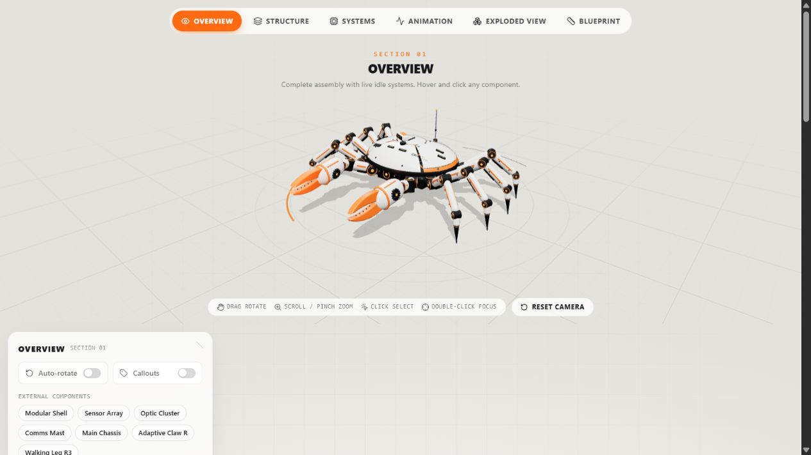

# Mechanical Crab 3D

**[Open the live demo](https://mechanical-crab-3d.vercel.app/)** · [GitHub repository](https://github.com/buildwahab/mechanical-crab-3d)

Explore the CR-01 Mechanical Crab in an interactive 3D engineering viewer. Inspect its procedural assembly, reveal internal components, separate parts, and experiment with articulated movement—all in the browser.

The project is published on GitHub and hosted on Vercel. The robot specifications, movements, and telemetry are illustrative simulations, not measurements from a physical robot.

[](https://mechanical-crab-3d.vercel.app/)

*Live demo preview captured on 6 November 2026, with callouts hidden for clarity.*

## Features

| Section | Explore |
| --- | --- |
| Overview | Orbit the complete assembly, inspect components, and toggle callouts or auto-rotation. |
| Internal Structure | Adjust armor opacity, hide system layers, and move a cross-section plane. |
| Component Explorer | Select individual components, read their descriptions, and focus the camera. |
| Movement Simulation | Try eight procedural animation modes, adjust the manual rig, and control playback. |
| Exploded View | Separate and reassemble parts with adjustable distance and transition speed. |
| Technical Blueprint | Switch camera presets and render styles, display dimensions, and inspect X/Y/Z cuts. |

Drag to orbit, scroll or pinch to zoom, click a part to inspect it, and double-click to focus. Use the camera presets or Reset to restore a view. Component lists and interactive schematics provide keyboard alternatives to selecting model geometry.

## Tech stack

| Area | Tools |
| --- | --- |
| Interface | React 19, TypeScript 5, Lucide React |
| 3D rendering | Three.js, React Three Fiber 9, Drei 10, three-stdlib |
| State and transitions | Zustand, GSAP |
| Styling | Tailwind CSS 4, clsx, tailwind-merge |
| Build and hosting | Vite 7, Vercel |

See `package.json` for dependency ranges and `package-lock.json` for exact resolved versions.

## Installation

Use Node.js 22.12 or newer and npm. A browser with JavaScript and WebGL support is required for the 3D viewer.

```sh
git clone https://github.com/buildwahab/mechanical-crab-3d.git
cd mechanical-crab-3d
npm ci --ignore-scripts
npm run dev
```

Open the localhost address printed by Vite. No API keys, accounts, environment variables, backend, or remote model downloads are required to run the project. Development and preview servers bind to `127.0.0.1`.

## Build and validation

```sh
npm run typecheck  # strict TypeScript validation
npm run validate   # typecheck, production build, pose and artifact checks
npm audit          # current dependency advisories, including development tools
npm run preview    # serve the built dist directory locally
```

`npm run build` generates the static site in `dist/`. Run it before `npm run preview` if you have not already run `npm run validate`.

The checks above are available project commands. For the checks actually performed during the original review, their scope, and their limitations, see [SECURITY_AUDIT.md](SECURITY_AUDIT.md). Dependency audit results are dated observations, not continuing security guarantees.

## Project structure

| Location | Purpose |
| --- | --- |
| `src/App.tsx` | Page composition, section effects, camera transitions |
| `src/store.ts` | Zustand state and GSAP transitions |
| `src/scene/Viewer.tsx` | Canvas, lighting, camera, dimensions, render updates |
| `src/creatures/types.ts` | Shared creature definition types |
| `src/creatures/registry.ts` | Creature library; only the crab is available |
| `src/creatures/crab/data.ts` | Components, illustrative specifications, animations, camera presets |
| `src/creatures/crab/parts.tsx` | Procedural model geometry and rig |
| `src/creatures/crab/pose.ts` | Pose generation and interpolation |
| `src/creatures/crab/CrabModel.tsx` | Per-frame rig updates |
| `src/three/` | Geometry/material caches, selection, camera API, live state |
| `src/ui/` | Panels, diagrams, section controls, timeline, reusable controls |
| `src/utils/cn.ts` | Class-name composition |
| `src/index.css` | Tailwind theme and custom styles |
| `scripts/validate.mjs` | Procedural animation and production artifact checks |
| `docs/images/` | Documentation preview assets |

## Deployment

The published site is available at **[mechanical-crab-3d.vercel.app](https://mechanical-crab-3d.vercel.app/)**. Source code is available in the public [GitHub repository](https://github.com/buildwahab/mechanical-crab-3d).

`vercel.json` configures the Vite build, `dist/` output, security headers, and hashed-asset caching. These configuration settings describe intended hosting behavior; they are not a substitute for checking the headers served by a live deployment.

For another static host, build the project, serve `dist/`, and apply equivalent headers. There is no client-side URL router, so catch-all rewrites are unnecessary. Hosting under a subdirectory requires setting Vite's `base` and rebuilding. Keep development servers private and serve the built output in production.

## Security and limitations

Read the [security audit and dated post-publication status](SECURITY_AUDIT.md). [COMMIT_FILES.txt](COMMIT_FILES.txt) records the original 33-file initial publication; later documentation additions are outside that historical list.

- Keep credentials out of source control. All `VITE_*` values are public browser configuration and must not contain secrets.
- The reviewed application uses local font fallbacks and procedural geometry; it does not require a third-party API.
- The 3D runtime is a substantial initial download, and the scene renders continuously. Mobile battery use and performance depend on the GPU. No physical-device performance benchmarks are provided.
- A WebGL fallback message is available when the viewer cannot render. Touch, assistive technology, and GPU compatibility still need broader release testing.

## License

No project license has been added. Third-party dependencies retain their respective licenses.
